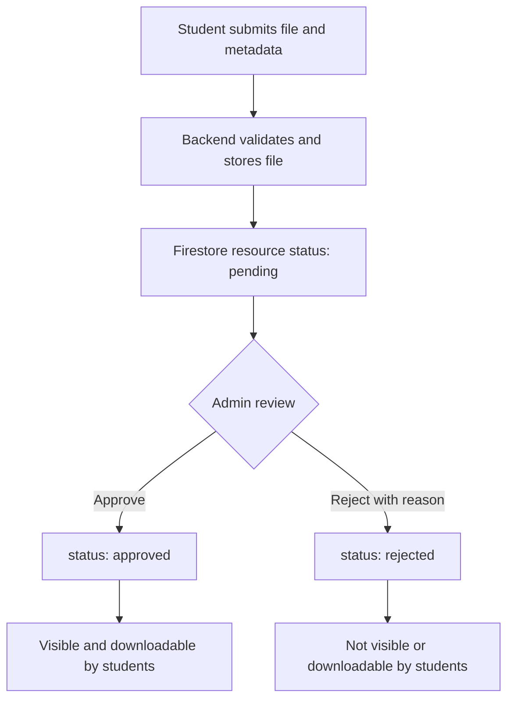

# NoteNest Logical Data Model

**Status:** Proposed v1.0 — aligned with [database-design.md](database-design.md).  
**Data platform:** Cloud Firestore + Firebase Authentication + Firebase Storage.

Firestore is document-oriented, so this is a logical relationship diagram rather than a relational SQL ER diagram. References are document ID fields, not enforced foreign keys.

## Logical relationship diagram

```mermaid
flowchart TD
    AUTH[Firebase Authentication]
    USER[users/{uid} profile and role]
    SEM[semesters/{semesterId}]
    SUB[subjects/{subjectId}]
    MOD[modules/{moduleId}]
    RES[resources/{resourceId} metadata and moderation]
    DL[resource_downloads/{downloadId}]
    FILE[Firebase Storage object]

    AUTH -->|UID identifies| USER
    SEM -->|semesterId| SUB
    SUB -->|subjectId| MOD
    SEM -->|semesterId filter reference| RES
    SUB -->|subjectId| RES
    MOD -.->|optional moduleId| RES
    USER -->|uploadedBy UID| RES
    USER -.->|reviewedBy admin UID| RES
    USER -->|userId| DL
    RES -->|resourceId| DL
    RES -->|storagePath| FILE
```

## Collections

| Collection | Document ID | Purpose |
|---|---|---|
| `users` | Firebase Auth UID | Application profile, role, account status |
| `semesters` | Generated/deterministic ID | Academic semester catalog |
| `subjects` | Generated/deterministic ID | Subject catalog; contains `semesterId` |
| `modules` | Generated/deterministic ID | Module catalog; contains `subjectId` |
| `resources` | Generated ID | Resource metadata, references, and moderation state |
| `resource_downloads` | Generated ID | Successful download activity |

## External Firebase Services

- **Firebase Authentication:** stores account identity and credentials. Passwords are not stored in Firestore.
- **Firebase Storage:** stores actual resource files. Firestore stores the `storagePath` only.

## Resource moderation lifecycle



## Integrity Rules

- A subject's `semesterId` must reference an existing semester.
- A module's `subjectId` must reference an existing subject.
- A resource's `semesterId` and `subjectId` must be consistent.
- If a resource has a `moduleId`, that module must belong to the same subject.
- `uploadedBy` must be derived from the verified Firebase ID token, not request input.
- Only a trusted admin can set `reviewedBy`, `reviewedAt`, `status`, and `rejectionReason`.
- A resource's `storagePath` must be generated by the backend and refer to its stored object.

## Important Difference from SQL

Firestore does not automatically enforce foreign keys, joins, or relational uniqueness constraints. Flask must validate document references and uniqueness rules. Query patterns may require composite indexes, which should be committed in `firestore.indexes.json` after they are finalized.

See [database-design.md](database-design.md) for field-level document shapes and implementation rules.
