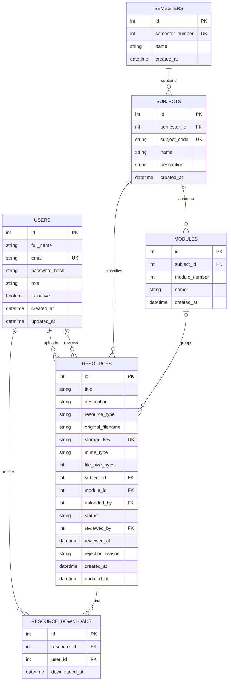
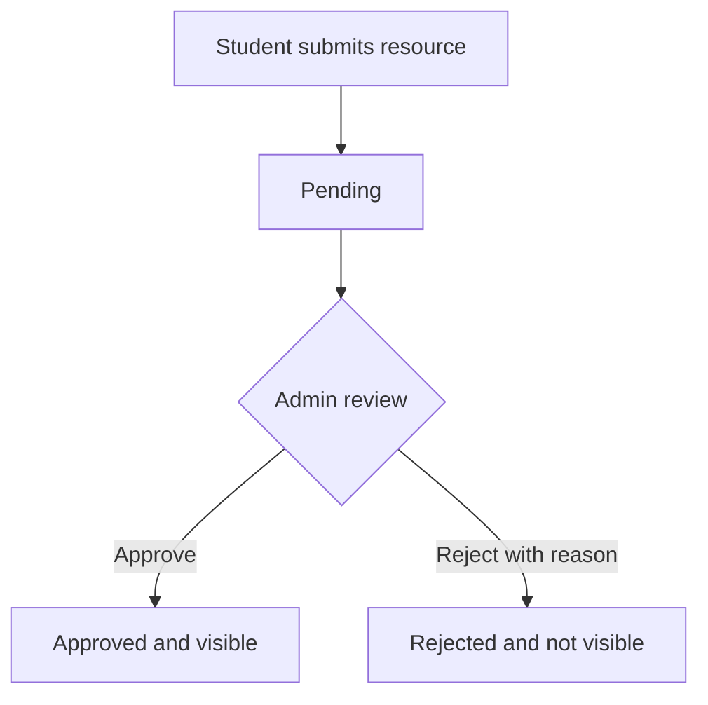

# Entity Relationship Diagram

**Status:** Proposed v1.0 — matches [database-design.md](database-design.md).  
**Database:** SQLite with Flask-SQLAlchemy.

## ER diagram

## Relationship explanation

| Relationship | Cardinality | Meaning |
|---|---|---|
| Semester → Subject | 1 : many | A semester contains multiple subjects; each subject belongs to one semester. |
| Subject → Module | 1 : many | A subject can contain multiple modules; each module belongs to one subject. |
| Subject → Resource | 1 : many | Each resource is classified under one subject. |
| Module → Resource | 1 : many, optional on resource | A resource may be for a specific module or the whole subject. |
| User → Resource (uploader) | 1 : many | A student can submit multiple resources. |
| User → Resource (reviewer) | 1 : many, optional on resource | An admin can review multiple resources; pending resources have no reviewer yet. |
| User → Resource Download | 1 : many | A user can download many resources. |
| Resource → Resource Download | 1 : many | A resource can be downloaded many times. |

## Moderation lifecycle

- New submissions always begin as `pending`.
- Only an administrator can approve or reject a submission.
- Only `approved` resources are searchable and downloadable by students.
- If the team adopts the proposed edit policy, editing an approved resource sends it back to `pending`.

## Important integrity rule

When a resource has both `subject_id` and `module_id`, the backend must ensure that the selected module belongs to that same subject. This cross-table rule should be validated by the application (or enforced with an additional composite foreign-key design if the team later chooses to add it).

The diagram and table definitions are proposed for team review. Do not create migrations until the team approves the schema and open decisions in [database-design.md](database-design.md).
